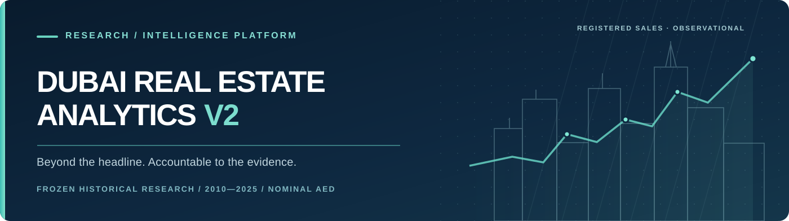
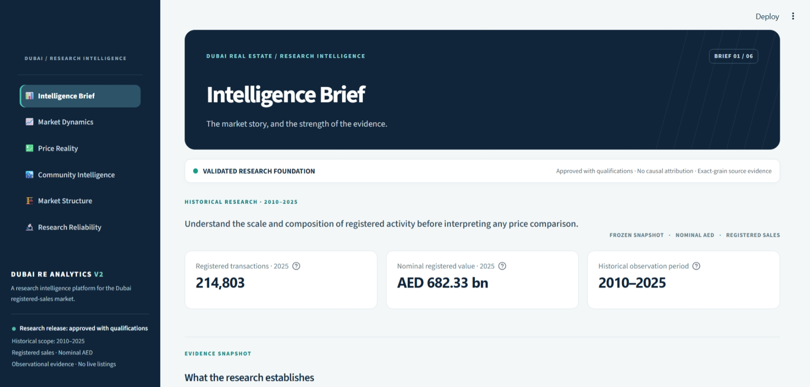
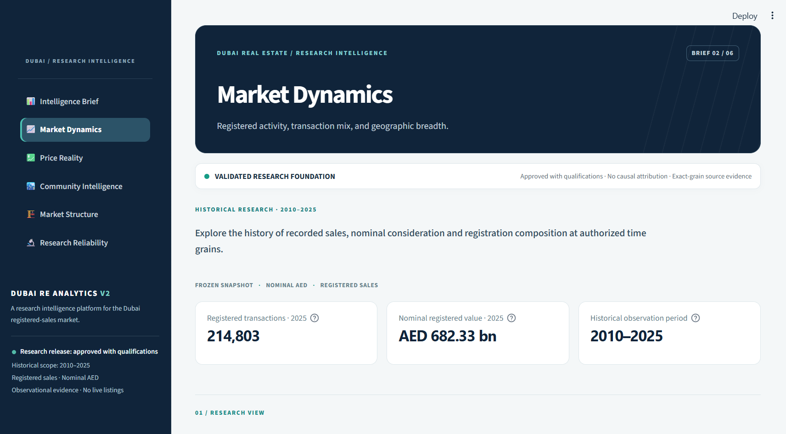
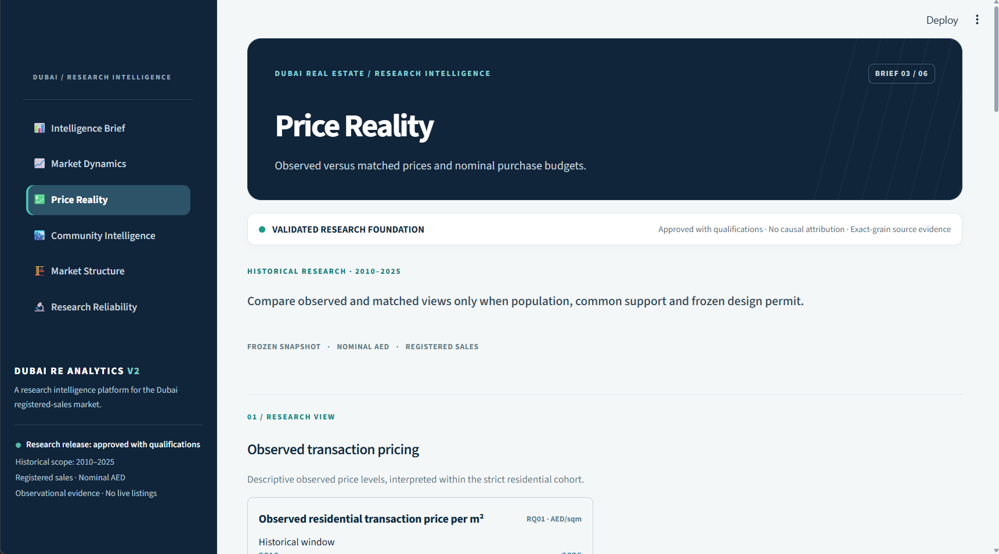
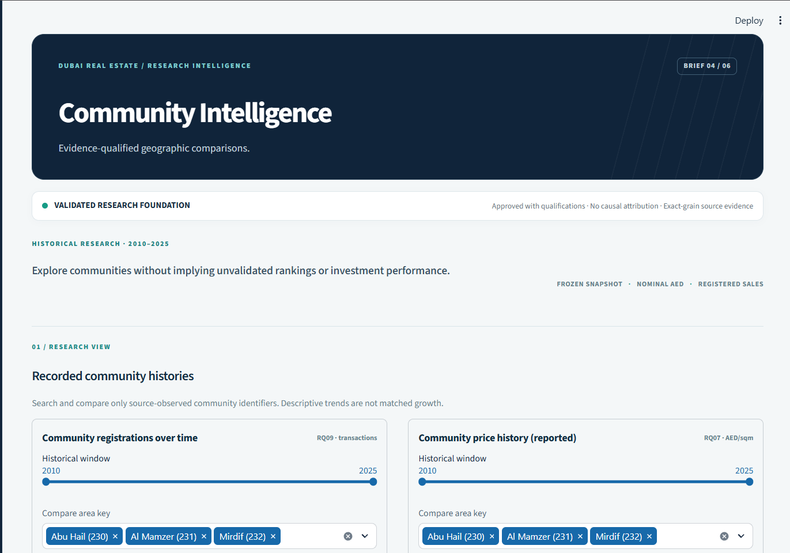
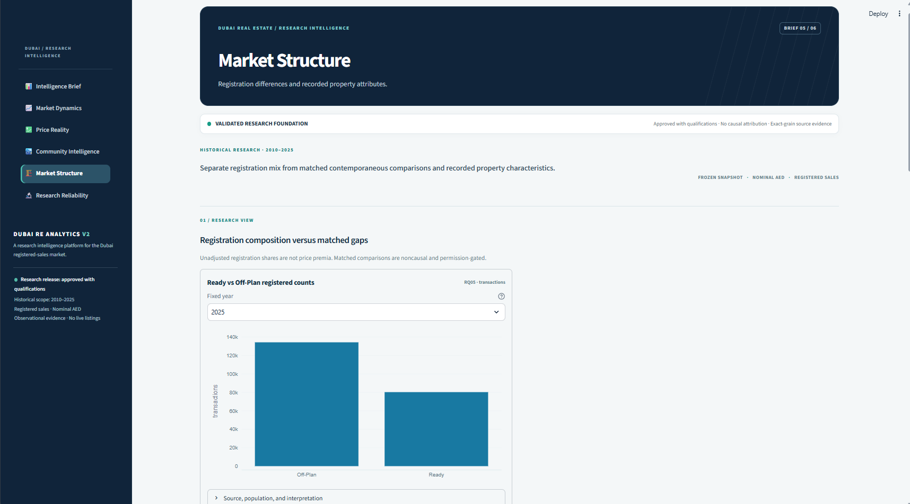
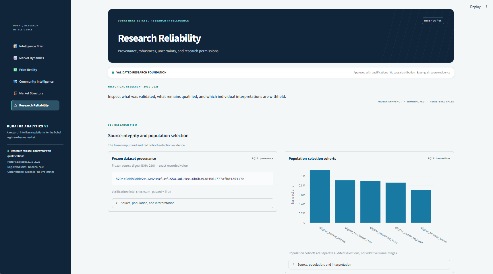
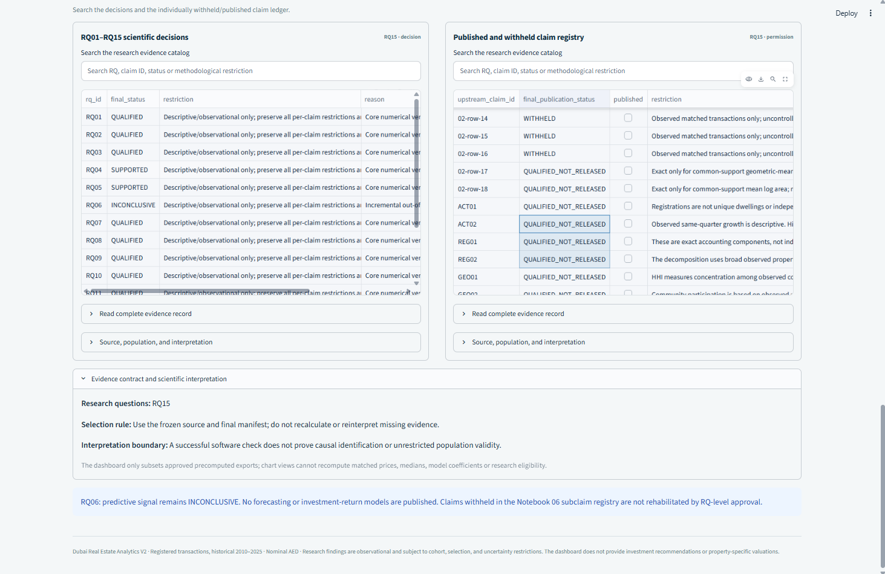
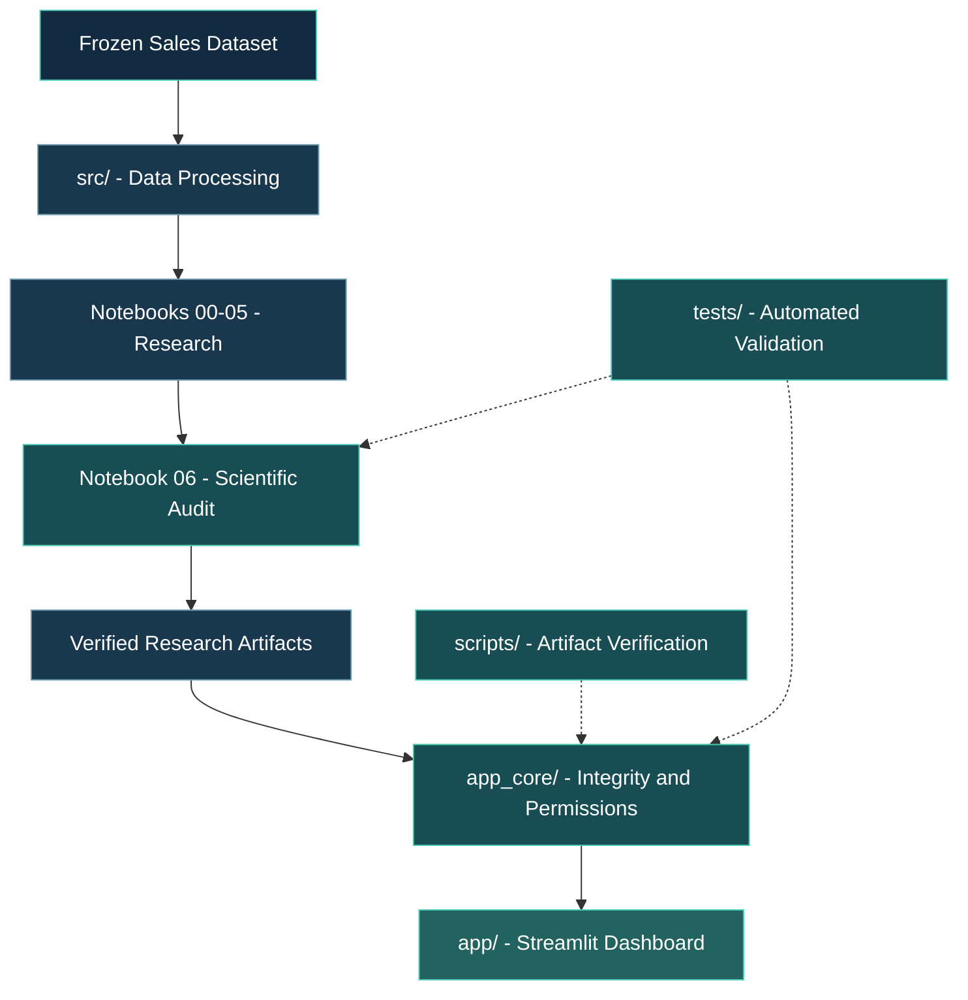

<p align="center">
  
</p>

<h1 align="center">Dubai Real Estate Analytics V2</h1>

<div align="center">

<p><strong>A market intelligence platform where the evidence sets the limits of the story.</strong></p>

<p>A research-led, six-page Streamlit experience examining Dubai's <strong>registered property sales</strong> through transaction activity, price composition, community comparability, market structure, and separately audited scientific claims.</p>

<p><strong>Frozen historical window: 2010–2025</strong> &nbsp;·&nbsp; <strong>Nominal AED</strong> &nbsp;·&nbsp; <strong>Observed sales, not listings</strong></p>

<p>
  <a href="#explore-the-dashboard"><strong>Explore the dashboard</strong></a> &nbsp;·&nbsp;
  <a href="#research-and-findings"><strong>Examine the research</strong></a> &nbsp;·&nbsp;
  <a href="#architecture"><strong>Architecture</strong></a> &nbsp;·&nbsp;
  <a href="#run-the-project"><strong>Run locally</strong></a> &nbsp;·&nbsp;
  <a href="#scientific-integrity"><strong>Scientific integrity</strong></a>
</p>

<br />


</div>

<br />

<table>
  <tr>
    <td align="center" width="25%"><strong>1,382,848</strong><br /><sub>Records in the frozen source snapshot</sub></td>
    <td align="center" width="25%"><strong>15</strong><br /><sub>Registered research questions</sub></td>
    <td align="center" width="25%"><strong>6</strong><br /><sub>Interactive research workspaces</sub></td>
    <td align="center" width="25%"><strong>215 / 215</strong><br /><sub>Local automated tests passing¹</sub></td>
  </tr>
</table>

> **The difference:** Most market dashboards stop at a chart. This project carries the chain of evidence further—**defined populations → prespecified estimands → research outputs → independent reconstruction → file-integrity checks → claim-level publication permissions → interactive visualizations.** A result that fails its scientific publication gate is not silently displayed as an insight.

<sub>¹ Latest user-executed verification on 24 November 2026: <code>python -m pytest -q -W error</code> → 215 passed. This is a local test result, not a claim of an automated CI build.</sub>

---

## The project at a glance

Dubai's registered-sale records offer a rich view of market activity, but a rising transaction count is not housing demand; a rising raw median is not necessarily comparable-home appreciation; and an observed association is not a causal premium.

**Dubai Real Estate Analytics V2** is designed around those distinctions. It combines an auditable research workflow with a read-only dashboard that presents what the frozen evidence supports—and makes unsupported interpretations visible rather than hiding them.

| Research dimension | What the system provides |
| :-- | :-- |
| **Market activity** | Annual and quarterly registered-sale counts, nominal recorded consideration, and registration-category composition |
| **Price reality** | Observed residential transaction prices, recorded size mix, nominal purchase-budget thresholds, and upper-tail concentration |
| **Community intelligence** | Audited area identities, observed histories, comparability gates, dispersion, and stability diagnostics |
| **Market structure** | Ready/Off-Plan registration counts, size–price patterns, bedroom support decisions, and parking feasibility |
| **Research reliability** | Frozen provenance, cohort sensitivity, source-field missingness, research decisions, and individual claim permissions |
| **Engineering controls** | An allowlisted artifact registry, SHA-256 readback checks, evidence-aware filters, tests, and fail-closed publication behavior |

### The 2025 lens — within this project's defined sales cohort

| Registered transactions | Nominal registered consideration | Analysis window |
| :--: | :--: | :--: |
| **214,803** | **AED 682.33 billion** | **2010–2025** |

These figures appear in the validated local dashboard's **Intelligence Brief** for 2025. They describe the project's specified historical transaction population, **not** all conceivable Dubai real-estate transactions, the market's outstanding property value, or an independently reconciled official market total. Monetary values are nominal, not inflation-adjusted.

---

## Explore the dashboard

The interface uses a consistent midnight-navy and teal design language, native Streamlit navigation, precomputed Plotly exhibits, and source-and-interpretation details alongside the evidence.

<p align="center">
  <a href="docs/assets/readme/01-intelligence-brief.png">
    
  </a>
  <br />
  <sub><strong>01 / Intelligence Brief</strong> — The executive layer: scale, composition, and scientific status in one view.</sub>
</p>

### Five more perspectives on the same evidence

<sub>Genuine screenshots from the locally running six-page dashboard. Click any image for the full-resolution capture.</sub>

<table>
  <tr>
    <td width="50%" valign="top">
      <a href="docs/assets/readme/02-market-dynamics.png"></a><br />
      <strong>02 / Market Dynamics</strong><br />
      <sub>Historical registrations, nominal values, composition, growth contributions, and concentration.</sub>
    </td>
    <td width="50%" valign="top">
      <a href="docs/assets/readme/03-price-reality.png"></a><br />
      <strong>03 / Price Reality</strong><br />
      <sub>Raw residential prices, fixed size classes, purchase-budget thresholds, and restricted matched evidence.</sub>
    </td>
  </tr>
  <tr>
    <td valign="top">
      <a href="docs/assets/readme/04-community-intelligence.png"></a><br />
      <strong>04 / Community Intelligence</strong><br />
      <sub>Named communities, transaction histories, eligibility decisions, dispersion, and stability.</sub>
    </td>
    <td valign="top">
      <a href="docs/assets/readme/05-market-structure.png"></a><br />
      <strong>05 / Market Structure</strong><br />
      <sub>Registration mix, recorded size–price relationships, bedroom support, and parking feasibility.</sub>
    </td>
  </tr>
  <tr>
    <td valign="top">
      <a href="docs/assets/readme/06-research-reliability.png"></a><br />
      <strong>06 / Research Reliability</strong><br />
      <sub>Frozen source digest, selection cohorts, missingness, sensitivity, and research permissions.</sub>
    </td>
    <td valign="top">
      <a href="docs/assets/readme/detail-research-permissions.png"></a><br />
      <strong>Evidence, not just presentation</strong><br />
      <sub>The research-question decision table and the individually published/withheld claim ledger.</sub>
    </td>
  </tr>
</table>

**An important product decision:** Unreleased analyses are presented as explicit evidence restrictions, not broken-looking placeholders. For example, the Market Structure workspace reports parking overlap feasibility while withholding a parking premium that the identification design cannot estimate. [View the actual support panel](docs/assets/readme/detail-market-structure.png).

---

## Research and findings

The research comprises seven notebooks—**00 through 06**—and 15 registered questions covering activity, pricing, composition, communities, attribute associations, and integrated robustness. The final notebook is a **separately reconstructed robustness and scientific acceptance layer**, not another decorative summary or an external peer review.

| Research conclusion | What can responsibly be said |
| :-- | :-- |
| **Registered market activity — RQ04** | **SUPPORTED** for the defined descriptive analyses of registered activity and historical structure. It does not establish buyer demand, housing supply, or transaction causation. |
| **Registration composition — RQ05** | **SUPPORTED** for observed Ready/Off-Plan categories and their registered shares. Registration mix is not a price premium. |
| **Raw vs. matched price change — RQ01** | **QUALIFIED** at the research-question level. Matched indices and endpoint exhibits require individual claim release and audited source binding; the current dashboard withholds them. |
| **Community comparisons — RQ07 and related questions** | Interpretation depends on common support, stable classifications, minimum sample coverage, and prespecified selection rules. Unreleased matched community-growth estimates are not exposed. |
| **Recorded size, bedrooms, and parking — RQ10–RQ12** | Descriptive size–price patterns and support decisions are visible; inferential coefficients remain claim-gated. Studio and 2-bedroom contrasts have **QUALIFIED** support decisions; 3, 4, and 5+ bedroom contrasts are **INCONCLUSIVE** in the displayed register. Parking premium: **NOT ESTIMABLE**. |
| **Prediction — RQ06** | **INCONCLUSIVE**. No market forecast, property-level valuation model, or investment-return prediction is published. |

The **parking diagnostic** reports **236,872 source parent observations** but only **9 communities with overlap** in the audited feasibility view. This is precisely why parent-sample size must not be mistaken for sufficient identifying support.

### Different questions require different populations

| Population | Intended use | Interpretation boundary |
| :-- | :-- | :-- |
| **P0 · All eligible registered sales** | Activity counts and recorded nominal consideration | Includes transaction types beyond built residential homes; transactions are not unique properties |
| **P1 Strict · Quality-screened residential Unit/Villa** | Observed AED/m² and residential price evidence | A selected, quality-screened transaction cohort—not a census of comparable homes |
| **P2 · Known comparable segments** | Matched/segmented research requiring observed classification fields | Reduced coverage and common-support constraints must be disclosed |

Selection, missingness, matching eligibility, reference windows, and uncertainty are research decisions—not free-form dashboard filters. The interface selects **precomputed approved rows**; it does not recompute medians, fit models, change reference weights, or manufacture new causal estimands.

### What is deliberately *not* claimed

No same-home repeat-sales appreciation; no rental yields; no listings or available inventory; no causal effect of Off-Plan status or parking; no income-based affordability measure; no forecast of future prices; and no investment recommendation. The 2026 portion of the source snapshot is **outside the frozen 2010–2025 research window**.

---

## Scientific integrity

<div align="center">

**APPROVED_WITH_QUALIFICATIONS**

<sub>Research-level release approval is not individual-claim publication permission.</sub>

</div>

<table>
  <tr>
    <td align="center" width="33%"><strong>28 / 37</strong><br /><sub>Exhibits with verified schemas and current permissions</sub></td>
    <td align="center" width="33%"><strong>9 / 37</strong><br /><sub>Intentionally claim-withheld exhibits</sub></td>
    <td align="center" width="33%"><strong>35</strong><br /><sub>Unique source artifacts in the exhibit catalog</sub></td>
  </tr>
</table>

<sub>Evidence state: local Phase 3 audit on 24 November 2026 (<code>SCHEMA_READY=28</code>, <code>CLAIM_WITHHELD=9</code>). The catalog includes files that are not individually cleared for public redistribution.</sub>

**Defense in depth, by design:**

1. **Frozen source provenance.** The source snapshot is identified by a recorded SHA-256 digest; the web app does not load or scan raw transactions to serve its views.
2. **An allowlisted artifact registry.** `app_core/artifact_registry.py` resolves fixed approved paths; the UI cannot invent artifact filenames.
3. **Saved-output integrity.** Notebook 06 exports are checked against a saved export manifest; upstream files are checked against a separate locally generated attestation.
4. **Publication permissions.** The release, RQ-level permission, individual `published` flag, optional claim approval, and audited exhibit-to-claim binding are distinct gates.
5. **Fail-closed behavior.** Missing evidence, hash mismatches, unsupported filters, unknown schema, or withheld claims cannot silently become numbers or zeroes.
6. **Research-specific interpretation.** Descriptive counts, conditional associations, support diagnostics, and model claims are not presented as interchangeable measurements.

The nine deliberately restricted exhibits cover matched index/coverage (**RQ01**), matched community growth (**RQ07**), size elasticity (**RQ10**), matched Ready–Off-Plan gaps and uncertainty (**RQ11**), and adjusted bedroom estimates (**RQ12**). No publication flags were altered to make the charts appear.

> **Integrity is not the same as scientific truth.** File hashes and passing software tests support reproducibility and tamper detection within the recorded evidence chain; they do not independently establish causal identification, statistical generalizability, or an individual result's permission to be published. The saved manifest is not allowed to certify its own hash.

---

## Architecture

The application separates **data processing**, **scientific decision-making**, and **presentation**. A Streamlit rerun can subset already approved source rows, but cannot rerun the research pipeline or mint new claims.



| Path | Responsibility |
| :-- | :-- |
| `src/` | Dataset loading, validation, cleaning, features, statistical utilities, and analysis modules |
| `notebooks/` | Seven staged research investigations, culminating in independent robustness and release decisions |
| `scripts/` | Artifact auditing, source attestation, and dashboard exhibit coverage checks; not a verified one-command research rebuild |
| `app_core/` | Read-only data-access contract, fixed artifact allowlist, source integrity, metric contracts, and scientific publication authorization |
| `app/` | Streamlit pages, navigation, analytics catalog, source-bound charts, components, and design system |
| `tests/` | Research regression tests and dashboard integrity, presentation, and permission-contract tests |
| `data/` | Local raw/intermediate/processed files and precomputed aggregates; distribution is controlled separately |
| `reports/` | Local exported evidence, audit tables, manifests, provenance, and release records |
| `docs/` | Implementation decisions, exhibit matrix, methodology notes, and README visual assets |

**Technical stack.** Python, Pandas, NumPy, PyArrow/Parquet, DuckDB, SciPy, Statsmodels, Plotly, Streamlit, JupyterLab, PyYAML, and pytest. See [`requirements.txt`](requirements.txt) for the repository's dependency bounds. No production database, cloud service, API, or CI deployment is implied here.

---

## Run the project

### 1 · Set up the environment

From the **repository root**, using Conda and PowerShell:

```powershell
# Create a new environment only if you do not already have dubai-v2.
conda create -n dubai-v2 python=3.11 -y
conda activate dubai-v2

python -m pip install -r requirements.txt
```

Python 3.11 is a practical environment choice for this snapshot, **not** an independently verified clean-install certification. The existing tested environment is named `dubai-v2`. The main requirements already cover the Phase 3 dashboard packages; `requirements_phase3.txt` is an older additive record.

### 2 · Provide the frozen research evidence

The source repository is **not a live-data client**. For a fully populated dashboard, the registered artifact paths must contain the exact frozen files approved by the research workflow:

```text
data/raw/dld_sales_transactions.parquet       # local frozen research source

data/aggregates/*.parquet                     # precomputed approved research outputs
reports/tables/06_export_manifest.parquet      # Notebook 06 saved export manifest
reports/tables/06_final_issue_register.csv     # final issue ledger
reports/tables/dashboard_upstream_attestation.json
```

Additional Notebook 06 permission/readiness/finalization exports in `data/aggregates/` are mandatory. The explicit allowlist is defined in [`app_core/artifact_registry.py`](app_core/artifact_registry.py), not inferred from this illustrative file list.

**Public clone vs. full local research environment:** The current `.gitignore` excludes `data/raw/`, `data/interim/`, `data/processed/`, and `data/aggregates/`. The exported files and attestation shown above were **not** bundled with this README. A source-only clone therefore does not automatically render the research figures. It will enter the intentional **release-unverified / evidence-unavailable** state until the verified artifacts are installed. Do not remove ignore rules or upload withheld estimates simply to make the charts appear.

To check the frozen raw-file identity in PowerShell:

```powershell
(Get-FileHash data/raw/dld_sales_transactions.parquet -Algorithm SHA256).Hash.ToLower()
```

<details>
<summary><strong>Expected frozen source SHA-256</strong></summary>

```text
8294c3dd83dde2e16e64eaf1ef155a1ad14ec16b6b39384561777afb8425417e
```

</details>

### 3 · Verify, then launch

```powershell
# From the repository root, with the frozen evidence installed.
python -m pytest -q -W error
python scripts/audit_dashboard_artifacts.py --root . --out reports/tables/dashboard_phase1_inventory.json
python scripts/check_phase3_dashboard.py --root .

streamlit run app.py
```

The coverage audit writes `reports/tables/dashboard_phase3_coverage.json`. On the last verified local run it reported **28 schema-ready** and **9 claim-withheld** exhibits. Missing files in a source-only checkout will not reproduce that full result; some integration tests also require the frozen source and research outputs.

The upstream attestation is a **separate verification artifact**: `scripts/attest_dashboard_upstream.py --root .` is intended for a fully validated local evidence set and refuses to overwrite an existing attestation. Do not regenerate it casually, modify stored digests, or bypass claim permissions.

---

## Data, reproducibility, and attribution

The frozen input is a Parquet snapshot of **registered Dubai sale transactions**, distributed by **[Dubai Real Estate Data on Hugging Face](https://huggingface.co/datasets/dubairealestatedata/dubai-real-estate-sales-transactions)** and described as based on **Dubai Land Department (DLD) data via Dubai Pulse**. The published dataset contains 1,382,848 records. The project's scientific window excludes 2026, even though the distributed source snapshot extends into that year.

**Dataset credit:** *Dubai Real Estate Data (dubairealestatedata.com), based on Dubai Land Department open data.* The dataset publisher identifies the dataset license as [CC BY 4.0](https://huggingface.co/datasets/dubairealestatedata/dubai-real-estate-sales-transactions/blob/main/LICENSE.md). This project is **independent** and is not affiliated with or endorsed by the DLD or the Government of Dubai.

The frozen SHA-256 above identifies the source actually used for this research. Since the upstream dataset can be refreshed, downloading its latest file is **not** a substitute for verifying byte identity before claiming an exact reproduction. See the publisher's [data dictionary](https://huggingface.co/datasets/dubairealestatedata/dubai-real-estate-sales-transactions/blob/main/DATA_DICTIONARY.md) and this project's [`docs/`](docs/) for methodological context.

**Publication boundary.** Raw and cleaned transaction records should not be committed by default. Some aggregate files also contain individually unreleased estimates. A public GitHub/Streamlit deployment must use a reviewed, redistribution-appropriate set of artifacts and must pass its own clean-copy smoke test. **No public deployment URL or such independent deployment acceptance has been established here.**

**Software license.** The external dataset's CC BY 4.0 license does **not** automatically license this repository's source code. Before inviting reuse, add a deliberate project-code license if one is intended; no license choice is assumed in this README.

---

## Responsible interpretation

- Registered transactions count **recorded sales**, not unique dwellings, available listings, or the total housing stock.
- Ready/Off-Plan are **registration classifications**, not automatically comparable property populations or causal treatments.
- Raw median AED/m² can shift with **property composition, coverage, geography, and quality selection**.
- The matched designs estimate **specified observational comparisons**, not same-property appreciation or causal effects.
- Cohort-selection bars are **separate audited selections**, not additive stages of a funnel.
- Community histories are not investment rankings; small samples, unstable identity, missing metadata, and common-support failures restrict interpretations.
- The dashboard deliberately contains **no rental-yield, forecasting, personal investment, or property-specific valuation advice**.

The guiding principle is simple: **when evidence is insufficient, show the boundary—not a confident number.**

---

## About the developer

**Anandhu Suresh** · Dubai Real Estate Analytics V2

A portfolio project demonstrating applied research design, Python analytics, data validation, statistical reasoning, interactive product development, and the discipline to keep scientific constraints visible in the finished experience.

<p>
  <a href="mailto:anandhu.suresh.dev@gmail.com"></a>
  <a href="https://www.linkedin.com/in/anandhu-suresh-in/"></a>
  <a href="https://github.com/anandhusuresh04"></a>
</p>

**[Email](mailto:anandhu.suresh.dev@gmail.com)** · **[LinkedIn](https://www.linkedin.com/in/anandhu-suresh-in/)** · **[GitHub](https://github.com/anandhusuresh04)**

---

<p align="center">
  <strong>DUBAI REAL ESTATE ANALYTICS V2</strong><br />
  <sub>Market intelligence, beyond the headlines. Research decisions before visual conclusions.</sub><br />
  <sub>Historical registered sales · 2010–2025 · Nominal AED · Observational evidence</sub>
</p>
